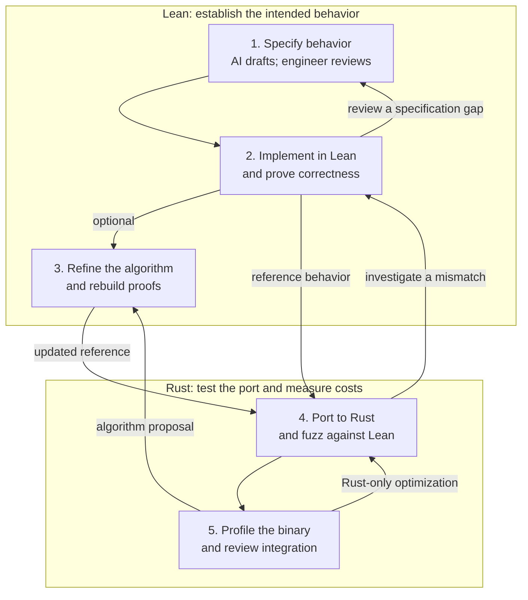

<!-- cspell:words allNonempty allNonemptyBool BoolCase BigUint ConstInputValue countNames Edsger firstName firstNameByMatch foldl Formedness graphql-lean hleft hmem hmemLeft hmemRight hright nonemptyNames nonNull rcases typeRef TypeRef usize -->

If you can read Rust, you already have a foothold in Lean. Functions, pattern matching,
and enum-like data provide familiar ground. From there, you can learn to read
specifications and recognize what a proof establishes.

That skill is useful even before you can write proofs yourself. When an AI agent
supplies a proof, you still need to decide whether the statement captures the
intended behavior. We'll build toward that skill through small examples, then
take an optional look at [`graphql-lean`](https://github.com/duckki/graphql-lean),
my GraphQL formalization. No installation or proof writing is required to follow along.

## Start with a function

Consider a function that returns the first name in a collection, if there is one.
In Rust, we could write:

```rust
fn first_name(names: Vec<String>) -> Option<String> {
    names.into_iter().next()
}
```

Here is the same idea in Lean:

```lean
def firstName (names : List String) : Option String :=
  names.head?
```

The shapes are familiar: a function name, an argument with a type, and a result type.
`def` introduces a definition, and `:=` introduces its body. `List String` and
`Option String` play familiar roles alongside `Vec<String>` and `Option<String>`.
Here the comparison concerns the sequence of values, rather than its storage.

Calling the function uses whitespace instead of parentheses: `firstName names`.
For `["Ada", "Grace"]`, the result is `some "Ada"`; for `[]`, it is `none`.
Lean's `some` and `none` correspond to Rust's `Some` and `None`.

## Lists and natural numbers

Read `List String` as a finite mathematical sequence of strings. Order matters, and
repetition is allowed: `["Ada", "Ada"]` has two elements.

A few expressions cover much of what we need:

| Lean expression | Meaning |
| --- | --- |
| `[]` | The empty sequence |
| `["Ada", "Grace"]` | A sequence of two names |
| `"Ada" :: names` | A sequence with Ada prepended |
| `left ++ right` | Concatenation, preserving order |
| `names.length` | The number of elements |

The length has type `Nat`: the natural numbers `0, 1, 2, …`, without a fixed upper bound.
Rust's [`num_bigint::BigUint`](https://docs.rs/num-bigint/latest/num_bigint/struct.BigUint.html)
provides a useful comparison. For reading the specification, think of a mathematical
nonnegative integer: a sequence has a length independently of its representation.

Functions can inspect the sequence using `match`:

```lean
def firstNameByMatch (names : List String) : Option String :=
  match names with
  | [] => none
  | name :: _rest => some name
```

The patterns divide the possibilities into an empty sequence and a first element
followed by the rest. This should feel familiar from Rust enum matching.

Anonymous functions use `fun`. For example, this keeps the nonempty names:

```lean
def nonemptyNames (names : List String) : List String :=
  names.filter (fun name => name != "")
```

The lambda resembles `|name| name != ""`. Lean infers the type of `name` from the list.
Local bindings use `let`, so a function can name an intermediate result:

```lean
def firstNonemptyName (names : List String) : Option String :=
  let filtered := nonemptyNames names
  firstName filtered
```

A left fold works like Rust's iterator `fold`:

```lean
def countNames (names : List String) : Nat :=
  names.foldl (fun count _name => count + 1) 0
```

A corresponding Rust expression is:

```rust
names.iter().fold(0usize, |count, _name| count + 1)
```

Starting with zero, the fold applies its step to each name in order:

```text
["Ada", "Grace"].foldl step 0
    = step (step 0 "Ada") "Grace"
    = 2
```

Lean already provides `length`; writing it as a fold makes the accumulator visible.
The Rust counter has a machine-sized bound, while the Lean result is a natural number.

## Structures and variants

The same familiarity extends to data declarations. Here is a definition from
[the operation model in `graphql-lean`](https://github.com/duckki/graphql-lean/blob/4b3b9e472d8515c3c5445eeceb1219120b85851f/GraphQL/Operation.lean#L38-L42),
with its `deriving` clause omitted:

```lean
structure VariableDefinition where
  name : Name
  typeRef : TypeRef
  defaultValue : Option ConstInputValue := none
```

`structure` is comparable to a Rust struct. Each field has a type, and the final field
has a default value. A variable definition has a name, a type reference, and an optional
constant default. In this model, `Name` is an alias for `String`.

An [`inductive` declaration](https://github.com/duckki/graphql-lean/blob/4b3b9e472d8515c3c5445eeceb1219120b85851f/GraphQL/Schema.lean#L312-L316)
can describe enum-like data:

```lean
inductive TypeRef where
  | named : Name -> TypeRef
  | list : TypeRef -> TypeRef
  | nonNull : TypeRef -> TypeRef
```

A type reference is a named type, a list of another type reference, or a non-null
wrapper. The arrows describe constructor arguments. Rust would express these
alternatives as enum variants.

Lean can infer the constructor's namespace from the expected type. Thus `.named "String"`
is shorthand for `TypeRef.named "String"`. Nested constructors describe more complex
GraphQL types:

```lean
def requiredStrings : TypeRef :=
  .nonNull (.list (.nonNull (.named "String")))  -- [String!]!
```

These declarations compose into larger models. The repository's `Operation` has a
`variableDefinitions : List VariableDefinition` field and a `selectionSet : List Selection`
field. Reading those types already tells us something useful about its shape.

## From computing answers to stating claims

So far, our functions have returned data. Lean also lets us define propositions: statements
that may be true or false, for which we can seek proofs.

Here is an executable test:

```lean
def allNonemptyBool (names : List String) : Bool :=
  names.all (fun name => name != "")
```

It computes `true` or `false`. Now consider a mathematical condition about the same names:

```lean
def AllNonempty (names : List String) : Prop :=
  ∀ name, name ∈ names → name ≠ ""
```

Read it as: “For every name, if that name belongs to the sequence, it is not the empty
string.” `Prop` marks this definition as a proposition. Defining it gives the condition
a name; it does not establish that a particular sequence satisfies it.

There are several new symbols, but each has a small job:

| Expression | Read it as |
| --- | --- |
| `a = b` | a equals b |
| `a ≠ b` | a does not equal b |
| `name ∈ names` | name belongs to names |
| `A ∧ B` | A and B |
| `A ∨ B` | A or B |
| `¬ A` | A is false |
| `A → B` | If A, then B |
| `∀ x, P x` | For every x, P holds |
| `∃ x, P x` | There exists an x for which P holds |

The distinction between `Bool` and `Prop` matters. `a == b` computes Boolean equality;
`a = b` states an equality. Similarly, `names.contains "Ada"` computes a Boolean, while
`"Ada" ∈ names` is a proposition. A Boolean test and a proposition can describe the same
property, but their relationship is something to establish. For these finite lists,
we can prove that `allNonemptyBool names = true` holds exactly when `AllNonempty names`
holds. Arbitrary propositions need not have a computable Boolean test: we can state
that a program halts without having an algorithm that decides termination for every
program and input.

Quantifiers express properties of whole collections. `∀ name ∈ names, name ≠ ""` is a shorter
way to write the condition above: “Every element is nonempty.” Existence works in the
other direction:

```lean
def HasAda (names : List String) : Prop :=
  ∃ name, name ∈ names ∧ name = "Ada"
```

This asks for a name that both belongs to the sequence and equals Ada. You could state
the same property more directly as `"Ada" ∈ names`; the longer form exposes the quantifier.

The arrow has a familiar role in function types too: `Nat → Nat` describes a function
from natural numbers to natural numbers. In a proposition such as `A → B`, it expresses
implication. When a specification reads `A → B → C`, read it as “assuming A and B, C.”

The roles are connected: a proof of `A → B` takes a proof of `A` and produces a
proof of `B`. An argument such as `(h : A)` names evidence that `A` holds. Lean's
[propositions-as-types explanation](https://lean-lang.org/theorem_proving_in_lean4/Propositions-and-Proofs/)
develops this connection further.

## A glimpse of a proof

Suppose we have two lists whose strings are all nonempty. Appending them should preserve
that property:

```lean
theorem allNonempty_append (left right : List String)
    (hleft : AllNonempty left) (hright : AllNonempty right)
    : AllNonempty (left ++ right) := by
  intro name hmem
  rcases List.mem_append.mp hmem with hmemLeft | hmemRight
  · exact hleft name hmemLeft
  · exact hright name hmemRight
```

The statement before `:= by` names two sequences and assumes that each satisfies
`AllNonempty`. It concludes that their concatenation satisfies the same condition.
For example, combining `["Ada"]` and `["Grace", "Edsger"]` introduces no empty strings.

The proof follows a small argument: any name in the concatenation came from either the
left or the right. In the first case, use the left assumption; in the second, use the
right assumption. Lean checks both cases.

Notice what the statement permits. `AllNonempty []` is true: there is no empty string
in an empty list. If your application requires at least one name, that requirement
needs its own assumption or conclusion.

You can review the contract without memorizing the tactics. Ask what the variables
range over, what the assumptions require, and whether the conclusion states the
behavior you need. The tactics construct a proof term that Lean's kernel checks.

## How this fits an engineering workflow

The same separation between a statement and its proof scales to larger algorithms.
In my GraphQL work, it supports a workflow that connects Lean definitions and proofs
to an executable Rust implementation:



**Define the specification.** AI drafts the model and required properties; the engineer
reviews their meaning. Repeat until the statement captures the intended behavior.

**Implement and prove correctness.** Build the Lean implementation and its proof together.
Revise code or proof as needed; a human decides when a finding calls for changing the
specification. An unfinished proof alone does not show the claim is false.

**Optionally refine within Lean.** Improve the algorithm or representation, rebuilding
correctness proofs after each change. This loop can repeat before any Rust port exists.

**Port to Rust and compare.** An agent working on Lean prepares a porting guide;
an agent working on Rust implements it and compares both programs on generated inputs.
Mismatches may reveal translation bugs; integration review can also expose a
specification gap or a limitation of the model.

**Profile Rust and feed ideas back.** Profile the concrete Rust binary for costs the
high-level Lean model is not intended to predict. Feed algorithm proposals back into
Lean refinement and proof rebuilding, then update and measure Rust again. Rust-specific
allocation or layout changes can remain within the Rust loop.

Agents can perform much of the iteration, while engineers review requirements and
decide when the contract should change. Each activity supplies different evidence:
proofs establish claims about the Lean model, differential fuzzing checks agreement
with the port, and profiling measures performance. The Rust port's agreement with
the model remains a testing result unless the translation is also verified.

The [static-analysis post](#from-the-verified-blueprint-to-a-practical-rust-engine)
shows this workflow in a concrete Rust library.

## A guided look around graphql-lean

The top-level `GraphQL/*.lean` files in
[`graphql-lean`](https://github.com/duckki/graphql-lean/tree/4b3b9e472d8515c3c5445eeceb1219120b85851f/GraphQL)
give concrete examples of the roles we have just read: schema and operation syntax,
validity predicates, and execution functions. The links here pin a repository snapshot
so you can follow the same definitions while reading.

`SchemaWellFormedness` and `Validation` define predicates used as assumptions in later
reasoning. Defining an operation's validity is distinct from implementing a validator
that computes a result. These files provide useful landmarks:

| Module | What to look for |
| --- | --- |
| [Schema](https://github.com/duckki/graphql-lean/blob/4b3b9e472d8515c3c5445eeceb1219120b85851f/GraphQL/Schema.lean) | Types, fields, input values, and type references |
| [Operation](https://github.com/duckki/graphql-lean/blob/4b3b9e472d8515c3c5445eeceb1219120b85851f/GraphQL/Operation.lean) | Selections, aliases, arguments, directives, and nesting |
| [SchemaWellFormedness](https://github.com/duckki/graphql-lean/blob/4b3b9e472d8515c3c5445eeceb1219120b85851f/GraphQL/SchemaWellFormedness.lean) | Conditions that make a schema well-formed |
| [Validation](https://github.com/duckki/graphql-lean/blob/4b3b9e472d8515c3c5445eeceb1219120b85851f/GraphQL/Validation.lean) | Conditions that make an operation valid |
| [Execution](https://github.com/duckki/graphql-lean/blob/4b3b9e472d8515c3c5445eeceb1219120b85851f/GraphQL/Execution.lean) | Field collection and modeled execution |

Additional developments live in subdirectories: `GraphQL/Theories/` contains constructions
such as query inclusion and its checker; `Proofs/GraphQL/` contains proofs; and
`Tests/GraphQL/` contains tests. This keeps the specification readable independently of
the algorithms and results developed from it. The
[conformance summary](https://github.com/duckki/graphql-lean/blob/4b3b9e472d8515c3c5445eeceb1219120b85851f/docs/spec-conformance.md)
describes the model's scope. For example, the main execution model covers queries,
while mutation execution and asynchronous resolver effects are outside it.

Pick one or two top-level files. Notice where a definition returns data, where it returns
`Bool`, and where it returns `Prop`. The [overview](https://github.com/duckki/graphql-lean/blob/4b3b9e472d8515c3c5445eeceb1219120b85851f/docs/overview.md)
provides more orientation. Recognizing the roles is useful before understanding every
helper or recursive definition. The model's documented scope and assumptions determine
what its results can justify in an application.

## Optional reading exercise: query inclusion

Compare `user { id name }` with `user { id }`. The first selects a larger footprint.
In [QueryInclusion](https://github.com/duckki/graphql-lean/blob/4b3b9e472d8515c3c5445eeceb1219120b85851f/GraphQL/Theories/QueryInclusion.lean#L85-L94),
`includes schema left right` asks whether the left covers the right's selected paths,
with additional conditions spelled out in the definition.

Try following three things in the source:

1. Which definitions return `Prop`, and which return `Bool`?
2. Where does `includes` quantify over assignments and paths?
3. What assumptions appear in `IncludesBoolReferenceSound` and
   `IncludesBoolReferenceComplete`, and which direction does each implication run?

Those last declarations state the correctness claims. This example snapshot contains
supporting lemmas but deliberately omits the final theorem witnesses. Defining a
proposition alone does not prove it.

For more context, follow
[ResponsePath](https://github.com/duckki/graphql-lean/blob/4b3b9e472d8515c3c5445eeceb1219120b85851f/GraphQL/Theories/ResponsePath.lean)
or the [query-inclusion notes](https://github.com/duckki/graphql-lean/blob/4b3b9e472d8515c3c5445eeceb1219120b85851f/docs/theories/query-inclusion.md).

## Start by reading the contract

You can begin reviewing Lean with the skills you already use to review Rust: follow
the data, inspect the branches, and ask what each function promises. Lean adds a way
to state those promises precisely and connect them to checked proofs.

Start with the inputs, assumptions, and conclusion. Then ask whether they describe
the application you are building. That judgment matters even when an AI agent writes
every proof step: a checked proof establishes the stated contract, and the engineer
decides whether that contract captures the requirement.

For a longer introduction, Lean's
[*Functional Programming in Lean*](https://lean-lang.org/functional_programming_in_lean/)
covers the programming language, while
[*Theorem Proving in Lean*](https://lean-lang.org/theorem_proving_in_lean4/)
develops the logic and proofs.
